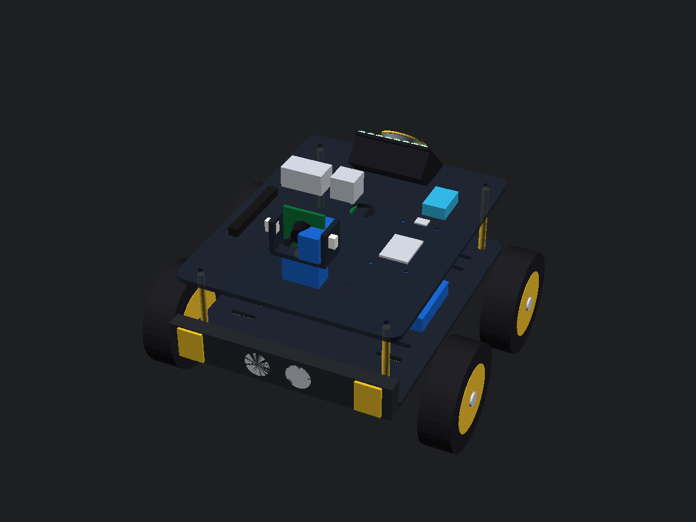

# Aura v1: Autonomous Mobile Companion Robot

Hi, I'm Shravan. **Aura v1** is an open-source autonomous companion robot (rover) I am building from scratch for [Hack Club Fallen](https://fallen.hackclub.com/projects/prj_kV1Fde). 

The goal of Aura v1 is to build an intelligent, mobile companion robot on a custom chassis that can follow me around my room, monitor ambient climate, act as a motion sentry, and connect to a stationary bedroom satellite pod for whole-home voice control.

---

## 🎥 Video Proof & Bench Demos

Here are the real test bench videos recorded on my desk showing each milestone:

1. **Live Vision Tracking & Sensor Telemetry HUD:** [Watch on YouTube Shorts](https://youtube.com/shorts/xNkBhOSDpR0)  
   *(Robot tracks human movement by pivoting BO motors while live temperature, humidity, and PIR sentry data stream to the HUD).*
2. **DHT11 & PIR Motion Sensor Bench Test:** [Watch on YouTube Shorts](https://youtube.com/shorts/FN-GSGQxdE8)  
   *(Testing both sensors in isolation on the ESP32-S3 before connecting the motor driver).*
3. **BO Motor Disassembly & Brush Repair:** [Watch on YouTube Shorts](https://youtube.com/shorts/L6oRBpswQRg)  
   *(Disassembled the stalling motor to clean internal brush contacts and commutator shaft).*
4. **Initial Human Centroid Tracking Loop:** [Watch on YouTube](https://youtu.be/JqQfvNIkbz4)  
   *(Verifying OpenCV face centroid offset calculations over serial).*

---

## 🛠️ Features (✅ = Built & Working on Bench)

- **Computer Vision Person Tracking** (MediaPipe/OpenCV with real-time serial steering). ✅
- **Dual-Chip Architecture** (Linux brain + zero-latency real-time microcontroller).
- **3S2P Battery Pack** (11.1V 4400mAh with BMS safety).
- **Acoustically Isolated Audio** (45° rear-firing speaker + upward MEMS mic).
- **Stationary Satellite Pod** (acts as a desk voice assistant for room control). ✅
- **DHT11 Environmental Telemetry** - Real-time indoor temperature and humidity logging streamed over serial to the companion dashboard. ✅
- **PIR Sentry Detection** - Low-power PIR motion sensing on GPIO 14 triggering immediate sentry alert badges. ✅
- **Custom KiCad Carrier PCB v1.1** - Dedicated motherboard with ESP32-S3 sockets and keyed sensor headers passing ERC with 0 errors. ✅
- **4WD Skid-Steer Locomotion** - 4x 200 RPM BO geared motors driven by an L298N dual H-bridge motor driver. ✅
- **Ultrasonic Emergency Braking** - Front distance monitoring for obstacle avoidance (currently bypassed while replacement sensor is in transit).

---

## 📐 3D CAD Chassis Design

The chassis plates are designed in OpenSCAD with dual-deck standoffs to hold the electronics securely:




---

## 🔌 System Architecture

```text
┌──────────────────────────────────────────────┐
│           Smartphone (DroidCam Stream)       │
│           (Live Video at 640x480 @ 30 FPS)   │
└──────────────────────┬───────────────────────┘
                       │
                       ▼
┌──────────────────────────────────────────────┐
│       Python OpenCV Companion Dashboard      │
│     (Face Tracking, Centroid Math, HUD)      │
└──────────────────────┬───────────────────────┘
                       │
                       ▼ USB Serial (115200 Baud)
┌──────────────────────────────────────────────┐
│              ESP32-S3 DevKit-C               │
│    (Motor Kinematics, Watchdog, Telemetry)   │
└──────────┬───────────────────────┬───────────┘
           │                       │
           ▼                       ▼
┌──────────────────────┐ ┌──────────────────────┐
│  L298N Motor Driver  │ │ Sensors (DHT11, PIR) │
│  (4WD Skid-Steer)    │ │ (GPIO 4 & GPIO 14)   │
└──────────────────────┘ └──────────────────────┘
```

---

## ⚡ Power Wiring Layout

```text
            ┌──────────────────────────────────────────┐
            │       3S 11.1V Li-ion Battery Pack       │
            └────────────────────┬─────────────────────┘
                                 │
                                 ▼
            ┌──────────────────────────────────────────┐
            │               3S 20A BMS                 │
            └────────────┬─────────────────┬───────────┘
                         │                 │
            (11.1V Line) │                 │ (11.1V Line)
                         ▼                 ▼
            ┌────────────────────┐ ┌────────────────────┐
            │    L298N Driver    │ │    XL4015 BUCK     │
            │    (Motor Power)   │ │    (Regulated 5V)  │
            └────────────┬───────┘ └─────────┬──────────┘
                         │                   │
                         ▼                   ▼
            ┌────────────────────┐ ┌────────────────────┐
            │   4x BO Motors     │ │    ESP32-S3 &      │
            │   (Chassis Drive)  │ │    Sensor Rails    │
            └────────────────────┘ └────────────────────┘
```

---

## 📦 Hardware Components Used on Bench So Far

| Item | Component | Specification / Model | Qty | Primary Role |
| :---: | :--- | :--- | :---: | :--- |
| 1 | ESP32-S3 | WROOM-1 N16R8 (16MB Flash, 8MB RAM) | 1 pc | Core MCU & Serial Bridge |
| 2 | Motor Driver | L298N Dual H-Bridge Module | 1 pc | 4WD Drive Power Stage |
| 3 | BO Motors & Wheels | 3-9V Dual Shaft BO Motor + 65mm Wheels | 4 pcs | Chassis Locomotion |
| 4 | Ultrasonic Sensor | HC-SR04 Distance Sensor | 1 pc | Obstacle Avoidance |
| 5 | Climate Sensor | DHT11 Temperature & Humidity | 1 pc | Environmental Readings |
| 6 | PIR Motion Sensor | HC-SR501 Passive Infrared Sensor | 1 pc | Sentry Motion Detection |
| 7 | Breadboard | MB-102 830 Points Solderless | 1 pc | Circuit Prototyping |
| 8 | Jumper Wires | Dupont M-to-M / M-to-F Assorted | ~40 pcs | Signal & Power Wiring |

---

## 📋 Bill of Materials (Hack Club Fallen Grant)

The full 16-item audited component list for the Hack Club Fallen hardware grant is saved in [`BOM.csv`](BOM.csv):

| Item | Component | Purpose on Aura v1 | Qty | Unit Price (INR) | Total (INR) | Total (USD) | Vendor |
| :---: | :--- | :--- | :---: | :---: | :---: | :---: | :--- |
| **1** | Raspberry Pi 4 Model B (1GB) | Main AI Brain & Computer Vision | 1 | ₹4,499 | ₹4,499 | \$47.53 | Robocraze.in |
| **2** | 160° Wide-Angle CSI Camera (OV5647) | Person Tracking & Auto-Docking | 1 | ₹939 | ₹939 | \$9.92 | Robu.in |
| **3** | TowerPro MG90S Metal Gear Servos | 2-Axis Pan-Tilt Camera Gimbal | 2 | ₹269 | ₹538 | \$5.68 | Robu.in |
| **4** | XL4015 5A DC-DC Buck Converter | 5.1V Clean Power Rail for Pi 4B | 1 | ₹110 | ₹110 | \$1.16 | Robocraze.in |
| **5** | LM2596S 3A DC-DC Buck Converter | 5.0V Rail for Servos & LEDs | 1 | ₹62 | ₹62 | \$0.66 | Robocraze.in |
| **6** | 18650 2600mAh Li-ion Cells (3S2P) | 11.1V 5200mAh High-Torque Pack | 6 | ₹149 | ₹894 | \$9.45 | MakerBazar.in |
| **7** | 3S 20A Li-ion BMS Protection Board | Battery Safety & Balance Protection | 1 | ₹49 | ₹49 | \$0.52 | MakerBazar.in |
| **8** | 12.6V 2A CC/CV Smart Charger | Auto-Docking Station Power Supply | 1 | ₹129 | ₹129 | \$1.36 | MakerBazar.in |
| **9** | ESP32-C3 SuperMini Board | Stationary Bedroom Satellite Pod | 1 | ₹254 | ₹254 | \$2.68 | Robocraze.in |
| **10** | INMP441 I2S MEMS Microphone | Digital Voice AI Input for Pi | 1 | ₹115 | ₹115 | \$1.22 | Robocraze.in |
| **11** | SmartElex MAX98357A I2S Amplifier | 3.2W Class-D Digital Audio Amp | 1 | ₹195 | ₹195 | \$2.06 | Robocraze.in |
| **12** | 3inch 4ohm 10Watt Speaker | Room Voice & Music Playback | 1 | ₹84 | ₹84 | \$0.89 | MakerBazar.in |
| **13** | WS2812 16 Bit RGB LED (round) | Visual State Feedback Lightbar | 1 | ₹78 | ₹78 | \$0.82 | Robocraze.in |
| **14** | SanDisk Ultra 64GB MicroSD Card | Raspberry Pi OS & AI Model Storage | 1 | ₹1,299 | ₹1,299 | \$13.72 | Amazon.in |
| **15** | HC-SR04 Ultrasonic Distance Sensor | Front Obstacle Collision Shield | 1 | ₹75 | ₹75 | \$0.79 | Robocraze.in |
| **16** | 40-Pin Dupont Jumper Wires Kit | Interconnect Wiring & Prototyping | 1 | ₹110 | ₹110 | \$1.16 | MakerBazar.in |
| **17** | 3x 18650 Battery Holder with Wire Leads | 3S2P Battery Pack Assembly (2x 3S in Parallel) | 2 | ₹49 | ₹98 | \$1.04 | Robu.in |
| **TOTAL** | **Complete System Grant Request** | **Aura Rover + Satellite Pod** | **17 Items** | **—** | **₹9,528** | **\$100.67** | **All Vendors** |

*Estimated at market rate of ₹94.65 INR per USD. Total grant request is **\$100.67 USD** *

---

## 🚀 How to Run Locally

### 1. Upload Microcontroller Firmware
Open this repository in VS Code with PlatformIO:
```powershell
pio run --target upload --upload-port COM6
```
*(Or open `src/main.cpp` in Arduino IDE, select ESP32-S3, and upload).*

### 2. Start the Vision Companion Dashboard
1. Open DroidCam on your phone and note the Wi-Fi IP (default is `http://192.168.31.75:4747/video`).
2. Run the tracker on your computer:
```powershell
python vision_tracker.py
```
*(Or double-click `run_vision_simulator.bat`).*

Controls:
- Stand in front of the camera and step left or right — the motors will steer to keep you centered.
- Press **W / A / S / D** on your keyboard to manually drive the motors.
- Press **Spacebar** to stop.
- Press **Q** to exit cleanly.
