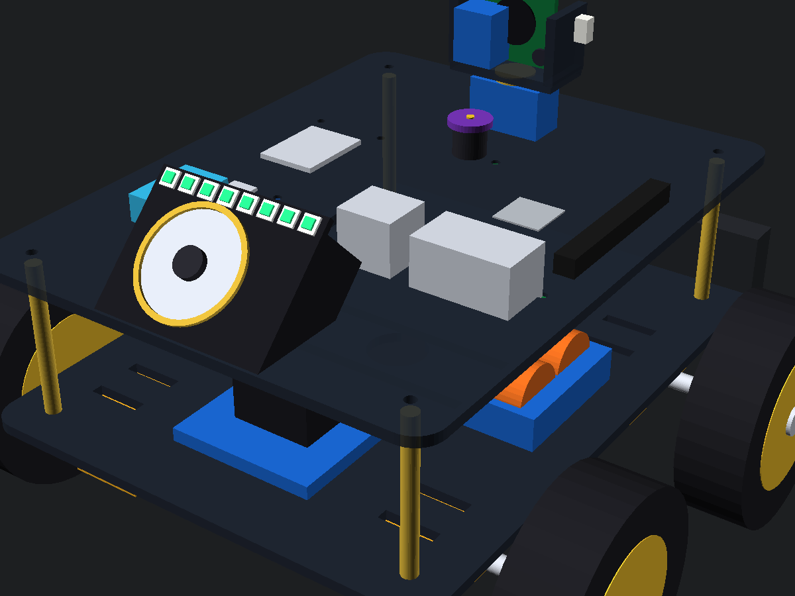

# Aura v1: Autonomous Companion Rover & Bedroom Satellite Pod

> *A comprehensive overview of the Aura v1 system architecture, bench-tested hardware, and software implementation in a single document.*

Hi! I'm Shravan Mali, an 18-year-old student and maker from India. This is **Aura v1**, an autonomous companion robot and bedroom satellite pod I am building from scratch for [Hack Club Fallen](https://fallen.hackclub.com/projects/prj_kV1Fde).

The idea behind Aura is to build a helpful robot for my room. It has two main parts:
1. **The Rover:** A 4WD mobile robot that tracks and follows me around the room using a camera, checks temperature and humidity, acts as a night motion sentry, and can count workout reps or play music on command.
2. **The Bedroom Satellite Pod:** A small stationary device plugged into the wall in my room. It connects to the rover over local Wi-Fi, listens for voice commands, controls my room's AC with an infrared transmitter, and lets me summon the rover to my room just by saying *"Aura, come here"*.

---

## Videos that shows physically working project.

I test and verify everything on my physical desk before moving to the next step. Here are three videos of the project working right on my desk:

1. **Live Vision Tracking & HUD:** [Watch on YouTube Shorts](https://youtube.com/shorts/xNkBhOSDpR0)  
   *(The rover tracks me by turning its BO motors left and right while streaming real-time temperature, humidity, and PIR motion data to my laptop screen).*
2. **DHT11 & PIR Motion Sensor Test:** [Watch on YouTube Shorts](https://youtube.com/shorts/FN-GSGQxdE8)  
   *(Bench testing room climate readings and motion detection on the ESP32-S3 before connecting the motor driver).*
3. **Face Centroid Tracking Loop:** [Watch on YouTube](https://youtu.be/JqQfvNIkbz4)  
   *(Testing real-time pixel offset calculations to steer the motors smoothly over serial).*

---

## What I've Built & Verified on My Desk

- **4WD Skid-Steer Motors:** 4x 200 RPM BO geared motors running on an L298N motor driver with ESP32 PWM soft-start so the motors don't jerk.
- **Real-Time Vision Following:** An OpenCV Python script (`vision_tracker.py`) that tracks human movement from a phone/webcam stream and steers the motors over USB serial at 115,200 baud.
- **Room Telemetry & Sentry:** A DHT11 sensor logging temperature and humidity every 2 seconds, plus a PIR motion sensor that triggers an alert badge if someone walks into the room.
- **Bedroom Satellite Pod PCB (v1.0):** A custom 2-layer PCB designed in KiCad. It houses the ESP32-C3 SuperMini, INMP441 mic, MAX98357A 3W amplifier, a 470µF bulk capacitor (to stop the speaker from rebooting the ESP32), an IR blaster, and an RGB LED ring. It passed KiCad DRC with **0 errors and 0 unconnected items**, and the fabrication Gerbers are ready.
- **Rover Carrier Board v1.5 Schematic:** The rover's motherboard schematic, verified with **0 ERC errors**. It separates high-current servo power from sensitive logic, adds I2S audio headers, and includes a 100kΩ/33kΩ resistor divider to monitor the 11.1V battery.
- **3D Chassis:** A dual-deck chassis designed in OpenSCAD to hold the motors, battery pack, electronics, and camera pan-tilt bracket.

---

## Features Coming Next (In Progress)

- **Exercise Rep Counter:** Using MediaPipe pose tracking on the camera to count push-ups or squats and check workout form.
- **Voice Music Playback:** Playing songs and voice responses through the I2S amplifier and 3W speaker via voice commands.
- **Auto-Docking:** Using the camera to detect an ArUco marker on a charging dock so the rover can drive itself to charge when the battery drops below 15% (`ADC <= 2940`).
- **Smart AC Control:** Blasting 940nm IR remote codes to turn the room AC on or off based on live temperature readings from the DHT11 sensor.

---

## How the System Works

```text
┌─────────────────────────────────────────────────────────────┐
│             AURA V1 AUTONOMOUS MOBILE ROVER                 │
│                                                             │
│   [ Raspberry Pi 4 Model B (1GB RAM) ]                      │
│   • High-Level Brain, OpenCV Computer Vision, Voice AI      │
│   • MediaPipe Pose Tracking (Exercise Rep Counter)          │
│   • ArUco Marker Autonomous Docking Navigation              │
│                              ▲                              │
│                              │ High-Speed UART / Serial     │
│                              ▼                              │
│   [ ESP32-S3 DevKit-C (N16R8) ]                             │
│   • Instant Real-Time Motor Kinematics (4WD PWM)            │
│   • 2-Axis Pan-Tilt Gimbal Servos (MG90S)                   │
│   • HC-SR04 Ultrasonic Emergency Braking (<1ms stop)        │
│   • 11.1V Battery Fuel Gauge ADC Monitor (Auto-dock <= 15%) │
└──────────────────────────────┬──────────────────────────────┘
                               ▲
                               │ Local Wi-Fi Mesh
                               ▼
┌─────────────────────────────────────────────────────────────┐
│             AURA BEDROOM SATELLITE POD                      │
│                                                             │
│   [ Stationary ESP32-C3 SuperMini Node (5V USB-C Powered) ] │
│   • 24/7 Room Listening Station (INMP441 + MAX98357A)       │
│   • Voice-Command Music & Media Playback (3W Speaker)       │
│   • Dedicated Room ID ("Aura, come here" summoning)         │
│   • 940nm IR Blaster + DHT11 Closed-Loop Room AC Control    │
│   • 470µF Bulk Capacitor (Prevents speaker inrush brownouts)│
└─────────────────────────────────────────────────────────────┘
```

---

## Custom KiCad Hardware & PCBs

All PCB design files, schematics, and manufacturing Gerbers are open-source in the [`hardware/`](hardware/) directory:

### 1. Bedroom Satellite Pod v1.0 (Fabrication-Ready PCB)
* **Directory:** [`hardware/Aura_Satellite_Pod/`](hardware/Aura_Satellite_Pod/)
* **Features:** 2-layer board, dual copper ground planes, 15.24mm DIP socket spacing for ESP32-C3 SuperMini, anti-brownout audio filtering, and 4 corner M3 mounting holes.
* **Status:** **0 DRC Errors, 0 Unconnected Nets**.
* **Files:** [Schematic PDF](hardware/Aura_Satellite_Pod/Aura_Satellite_Pod_Schematic.pdf) | [Manufacturing Gerbers Zip](hardware/Aura_Satellite_Pod/Gerbers_Aura_Satellite_Pod_v1.0.zip) | [3D Front Render](hardware/Aura_Satellite_Pod/3d_pcb_front.png) | [3D Back Render](hardware/Aura_Satellite_Pod/3d_pcb_back.png)

### 2. Rover Carrier Motherboard v1.5 (Schematic Complete)
* **Directory:** [`hardware/Aura_v1.5_Carrier/`](hardware/Aura_v1.5_Carrier/)
* **Features:** Dual isolated buck power rails (`+5V` logic, `+5V_SERVO`), I2S audio inputs/outputs, L298N motor headers, and battery fuel gauge ($100\text{k}\Omega / 33\text{k}\Omega$).
* **Status:** **0 ERC Errors**.
* **Files:** [Schematic PDF](hardware/Aura_v1.5_Carrier/Aura_v1.5_Carrier_Schematic.pdf)

---

## Bill of Materials 

I keep two separate BOM files to be 100% transparent about what I already have on my desk and what I need funding for from Hack Club:

1. **[BOM.md](BOM.md) (Hack Club Fallen Grant Request):**  
   The exact 17 audited items requested through the Hack Club Fallen virtual card totaling **₹9,528 (~$100.67 USD)**, with clickable vendor purchase links for reviewers.
2. **[Aura_Master_BOM.md](Aura_Master_BOM.md) (Complete 0-to-100 Hardware Inventory):**  
   The complete system build (32 subsystems totaling ₹11,848), clearly separating:
   * **Owned by me (I have on my desk):** ₹2,320 (15 subsystems: ESP32-S3, BO motors, wheels, L298N, chassis, sensors, passives).
   * **Requested from Hack Club Fallen:** ₹9,528 (17 subsystems: Pi 4, CSI camera, MG90S servos, Li-ion 18650 pack, BMS, charger, satellite components).

---

## 3D Chassis Design

The chassis is designed in OpenSCAD with dual-deck standoffs to hold the battery pack, motor drivers, and boards securely:




---

## How to Run Locally

### 1. Upload Microcontroller Firmware
Open this repository in VS Code with PlatformIO:
```powershell
pio run --target upload --upload-port COM6
```
*(Or open `src/main.cpp` in Arduino IDE, select ESP32-S3 Dev Module, and upload).*

### 2. Start the Computer Vision Dashboard
1. Open DroidCam on your phone (or plug in a USB webcam).
2. Run the tracking script on your computer:
```powershell
python vision_tracker.py
```
* **Keyboard Driving:** Press **W / A / S / D** to drive manually, **Spacebar** to brake, **Q** to quit.
* **Auto-Follow:** Stand in front of the camera; the BO motors will automatically steer left/right to keep you centered.
