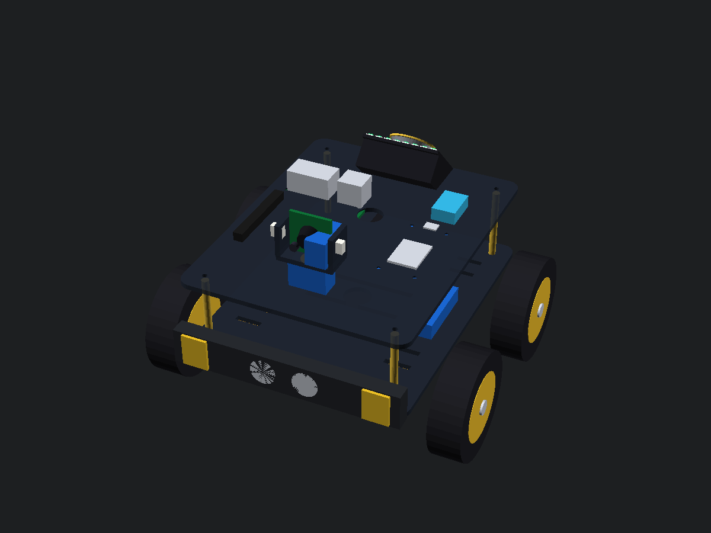
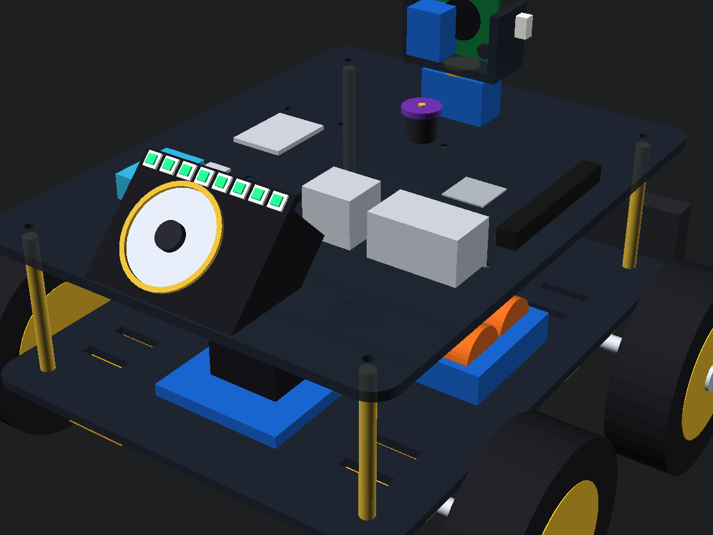

# Aura v1 - Companion Rover & Bedroom Satellite Pod

Hi! I'm Shravan Mali, an 18-year-old student and maker from India. This is Aura v1, an autonomous companion robot and bedroom satellite pod I am building from scratch for [Hack Club Fallen](https://fallen.hackclub.com/projects/prj_kV1Fde).

The idea behind Aura is to build a helpful robot for my room. It has two main parts:
1. The Rover: A 4WD mobile robot that tracks and follows me around the room using a camera, checks temperature and humidity, acts as a night motion sentry, and can count workout reps or play music on command.
2. The Bedroom Satellite Pod: A small stationary device plugged into the wall in my room. It connects to the rover over local Wi-Fi, listens for voice commands, controls my room's AC with an infrared transmitter, and lets me summon the rover to my room just by saying "Aura, come here".

## Physically Working Videos

I test and verify everything on my desk before moving to the next step:

1. Live Vision Tracking & HUD: [Watch on YouTube Shorts](https://youtube.com/shorts/xNkBhOSDpR0) (rover turns its BO motors left and right while streaming real-time temperature, humidity, and PIR motion data to my laptop screen).
2. DHT11 & PIR Motion Sensor Test: [Watch on YouTube Shorts](https://youtube.com/shorts/FN-GSGQxdE8) (bench testing room climate readings and motion detection on the ESP32-S3 before connecting the motor driver).
3. Face Centroid Tracking Loop: [Watch on YouTube](https://youtu.be/JqQfvNIkbz4) (testing real-time pixel offset calculations to steer the motors smoothly over serial).

## What I've Built on My Desk

- 4WD skid-steer chassis running 4 BO geared motors through an L298N driver with ESP32 PWM soft-start.
- Real-time vision following using OpenCV (`vision_tracker.py`) to detect faces from a phone stream and send steering commands over USB serial at 115200 baud.
- Room telemetry logging temperature and humidity with a DHT11 and motion alerts with a PIR sensor.
- Bedroom Satellite Pod PCB (v1.0) designed in KiCad for an ESP32-C3 SuperMini, INMP441 microphone, MAX98357A 3W amplifier, 470µF bulk capacitor, IR blaster, and LED ring. The board passed DRC with 0 errors and 0 unconnected nets, and gerbers are generated.
- Rover Carrier Motherboard PCB designed in KiCad with isolated power rails for servos and Pi, reverse-polarity protection, and battery monitoring divider.
- Dual-deck chassis modeled in OpenSCAD to hold the acrylic plates, motors, battery pack, and camera gimbal.

## Features Coming Next

- Exercise rep counter using MediaPipe pose tracking on the camera to count push-ups or squats.
- Voice music playback through the I2S amplifier and 3W speaker via voice commands.
- Auto-docking using the camera to detect an ArUco marker on a charging dock when the battery drops below 15%.
- Smart AC control using the 940nm IR transmitter to turn the room AC on or off based on DHT11 temperature.

## System Architecture

The project is split between the mobile rover and the wall-powered bedroom satellite pod:

**Mobile Rover:**
- Raspberry Pi 4 (1GB) handles computer vision, OpenCV face tracking, and high-level decisions.
- ESP32-S3 runs the real-time hardware loop: 4WD motor control, pan-tilt gimbal servos, battery voltage monitoring, and sensors.
- Pi and ESP32 communicate over high-speed USB serial at 115200 baud.

**Bedroom Satellite Pod:**
- Stationary ESP32-C3 SuperMini plugged into 5V USB wall power.
- Listens for voice input through an INMP441 I2S microphone and plays audio through a MAX98357A amplifier and 3W speaker.
- Connects to the rover over local Wi-Fi and controls the bedroom AC using a 940nm IR emitter.

## Custom KiCad Hardware & PCBs

All PCB design files, schematics, and manufacturing Gerbers are in the `hardware/` directory:

### 1. Bedroom Satellite Pod v1.0 (Fabrication-Ready PCB)
- Directory: [`hardware/Aura_Satellite_Pod/`](hardware/Aura_Satellite_Pod/)
- Features: 2-layer board, dual ground planes, 15.24mm socket spacing for ESP32-C3 SuperMini, anti-brownout audio filtering capacitor, and 4 corner M3 mounting holes.
- Status: Passed KiCad DRC with 0 errors and 0 unconnected nets.
- Files: [Schematic PDF](hardware/Aura_Satellite_Pod/Aura_Satellite_Pod_Schematic.pdf) | [Manufacturing Gerbers Zip](hardware/Aura_Satellite_Pod/Gerbers_Aura_Satellite_Pod_v1.0.zip) | [3D Front Render](hardware/Aura_Satellite_Pod/3d_pcb_front.png) | [3D Back Render](hardware/Aura_Satellite_Pod/3d_pcb_back.png)

### 2. Rover Carrier Motherboard (Final Production PCB)
- Directory: [`hardware/Aura_Rover_Carrier_Final/`](hardware/Aura_Rover_Carrier_Final/)
- Features:
  - Dual power rails: dedicated 5.1V logic rail (XL4015 buck) for Raspberry Pi 4B, and 5.0V actuator rail (LM2596S buck) with 470µF bulk capacitor for MG90S servos and NeoPixels.
  - Reverse polarity and auto-docking protection using P-channel MOSFET and SS54 Schottky diode.
  - High-current motor rail powering L298N drive motors directly from 11.1V battery.
  - Raspberry Pi hardware watchdog circuit (2N2222 to GLOBAL_EN) to recover if Linux freezes.
  - Power indicator LEDs, piezo buzzer, and I2C sensor expansion port.
- Status: Passed KiCad DRC and ERC with 0 errors and 0 unconnected nets. Gerbers generated for JLCPCB.
- Files: [KiCad Schematic](hardware/Aura_Rover_Carrier_Final/Aura_Rover_Carrier_Final.kicad_sch) | [Schematic PDF](hardware/Aura_Rover_Carrier_Final/Aura_Rover_Carrier_Final_Schematic.pdf) | [PCB File](hardware/Aura_Rover_Carrier_Final/Aura_Rover_Carrier_Final.kicad_pcb) | [Manufacturing Gerbers Zip](hardware/Aura_Rover_Carrier_Final/Gerbers_Aura_Rover_Carrier_Final.zip) | [BOM CSV](hardware/Aura_Rover_Carrier_Final/Aura_Rover_Carrier_Final_BOM.csv) | [3D Top View](hardware/Aura_Rover_Carrier_Final/3d_pcb_carrier_top.png) | [3D Isometric View](hardware/Aura_Rover_Carrier_Final/3d_pcb_carrier_iso.png)

### 3. Historical Iteration Archive
All prior hardware revisions from prototype v1.0 through v1.5 are preserved in [`hardware/archive/`](hardware/archive/).

## Bill of Materials

I keep two BOM files:

1. [BOM.md](BOM.md) - Hack Club Fallen Grant Request: 17 items requested through the grant totaling ₹9,528 (~$100.67 USD), with clickable vendor purchase links for reviewers.
2. [Aura_Master_BOM.csv](Aura_Master_BOM.csv) - Complete hardware inventory: 32 subsystems totaling ₹11,848, separating what I already own on my desk (₹2,320) from what is requested through the grant (₹9,528).

## 3D Chassis Design

The chassis is designed in OpenSCAD with dual-deck standoffs to hold the battery pack, motor drivers, and electronics:





## How to Run Locally

### 1. Upload Microcontroller Firmware
Open this repository in VS Code with PlatformIO:
```powershell
pio run --target upload --upload-port COM6
```
*(Or open `src/main.cpp` in Arduino IDE, select ESP32-S3 Dev Module, and upload).*

### 2. Start the Computer Vision Dashboard
1. Open DroidCam on your phone (or plug in a USB webcam).
2. Run the tracking script on your computer:
```powershell
python vision_tracker.py
```
- Keyboard Driving: Press W / A / S / D to drive manually, Spacebar to brake, Q to quit.
- Auto-Follow: Stand in front of the camera; the BO motors will automatically steer left/right to keep you centered.
